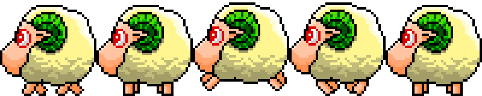
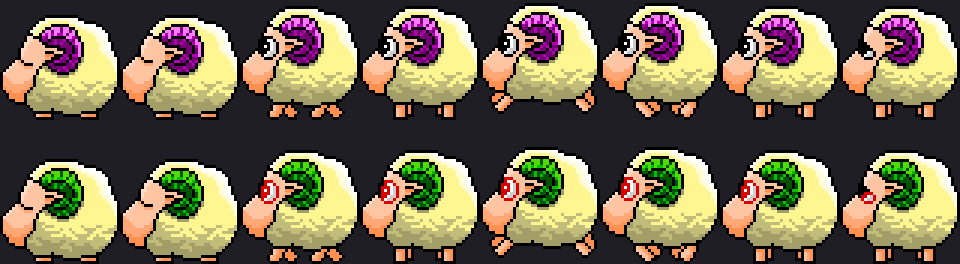
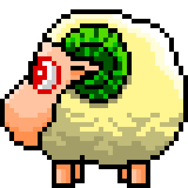
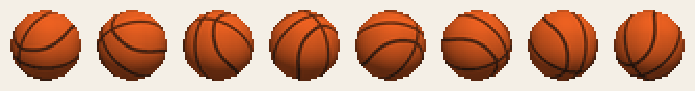
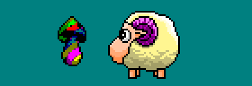
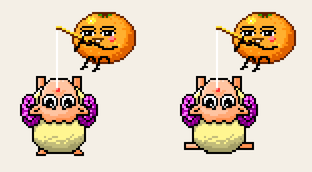

<meta charset="UTF-8">

# STRAY SHEEP The Screen Mate (Scmpoo)



_STRAY SHEEP The Screen Mate_ (Japanese: STRAY SHEEP スクリーンメイト) is a [digital pet](https://en.wikipedia.org/wiki/Digital_pet) / Windows **screen mate** based on Fuji TV's multimedia project _STRAY SHEEP_ (Japanese: ストレイシープ). The application includes character animations from Fuji TV's late-night series _The Adventure of STRAY SHEEP_ (1994), featuring Poe, Merry, and the alien Hue.

This repository is based on the C reconstruction in [lwu309/Scmpoo](https://github.com/lwu309/Scmpoo), which recovers the original 16-bit New Executable for modern 32/64-bit Windows. This fork adds an English UI translation, an alien sheep mode, a sports ball, a mushroom trip, and a shared life with the [Orange](https://github.com/jakovradojevic/Orange) screen mate.

Compiled executables for the upstream project are on its [Releases](https://github.com/lwu309/Scmpoo/releases) page.

---

## Alien sheep mode — recreated from memory

Some older / alternate builds of Scmpoo were remembered as having a rarer “alien” Poe: **green horns**, **red eyes**, a distinct UFO abduction, then an aggressive spell on the desktop. The publicly recovered EXE only shipped the normal purple-horn sheep sheets — that alien look was not in the bitmaps.

This fork rebuilds that remembered behaviour **from memory and reverse-engineering of the existing screen mate**, not from a dumped alien-mode binary:

1. **Sprites** — every locomotion sheet (`101`–`111`) is recolored into `112`–`122` (green horns + red pupils), generated by `tools/generate_alien_sheep_bmp.py`.
2. **Sequence** — red UFO beam abduction → sheep falls back with gravity → brief landing pose → temporary alien overlay on the **normal** AI (walk, climb, windows, taskbar, drag).
3. **Aggression** — while alien, Poe chases other instances faster, knocks them into a roll, and they sometimes panic-flee.
4. **Rarity** — alien abduction is wired into the same special-action table as the other UFO events, so it stays uncommon.



*Top: stock Poe · Bottom: alien recolor (green horns / red eyes)*




*Landing poses used on impact after the alien drop (handstand-sheet cells 4 and 6)*

### Trying alien mode

- Let special actions fire naturally (same rarity class as other UFO scenes), or  
- **Ctrl+Shift+double-click** Poe → debug dialog → **Alien**.

Run several instances to see chase / knock / flee against normal sheep. While alien, a knock on the orange makes it flinch. If the orange is the toy, the same knock kicks it across the desktop.

---

## Sports ball

Action 175 in the random table spawns one shared ball, either the football (`126.bmp`) or the basketball (`127.bmp`), then the sheep charges and headbutts it. The ball spins, bounces, and plays a hit sound. Drag it to pick it up and let go to throw it. It stays above the taskbar, and above ordinary windows, so the sheep are kicking something that is actually on screen.




While a ball exists, the orange will not turn into a toy. An idle orange can chase the same ball and kick it back.

---

## Mushroom graze and the acid trip

A rarer action plants a mushroom at the cursor, hides the system pointer, and sends Poe over to graze. The mushroom shrinks as it is eaten. Afterwards he startles, then the horns and eyes cycle through acid colours while he spins, bounces, and blinks. A looping trance plays for the trip. Colour returns to normal when it ends.




---

## Life with the orange

[Orange](https://github.com/jakovradojevic/Orange) is a separate program. The two talk through `mate_protocol.h` (the same header in both trees) and a small hidden director window. Messages are `WM_USER`, so both processes have to run at the same integrity level. Neither one asks for administrator.

### Floor

Feet stop at the top of a taskbar docked to the bottom of the monitor. An auto-hiding taskbar, or a taskbar on another edge, does not count. The same rule is in both programs, including the ball.

### Toy, then flower

If no ball is on screen and no orange is already a flower, the director occasionally asks an idle orange to stand still as a toy (about a minute and a half of eligible time, then one minute of standing). When that minute ends, the orange blooms: it splits and a flower grows. The nearest free sheep walks over and eats it. While the sheep chews, the flower closes in reverse. After the meal the sheep's horns stay orange for about two minutes, then fade back.

A real ball arriving during the toy minute ends the toy immediately and the orange blooms early. A ball on screen also blocks a new toy from starting.

### Fishing

Calm fishing and the flying cast are both in the orange's random actions. The flying cast is the rarer of the two. `Orange.exe --fish` starts that cast immediately. During that cast the orange hooks at most one nearby sheep, carries it from the red bobber, and lets go when the flight ends. The sheep plays the last two frames of `103.bmp` (arms up) and is kept above the taskbar for the whole carry.



### Hourly chime

On the hour the director tells every registered mate. The orange, if idle, pauses and cries. The sheep still follows its own "Hourly chime" setting.

---

## Usage

Poe appears on the desktop and usually picks run or walk. Some actions play his voice. Every gesture from the debug list is also in the random pool. UFOs, Merry, burning, the alien, and the fall are the rarest slots. Turn and collision still happen on their own while he is moving.

He reacts to visible windows (collisions, landing on top edges when gravity is on). Up to 8 instances can run at once; they can bump into each other.

- **Drag** with left/right mouse to move him.
- **Drop a file** on him to “eat” it (`.wav` plays).
- **Left double-click** — settings (crying, hourly chime, always move, gravity, always on top). The `.ini` is written next to the executable.
- **Right double-click** — exit.
- **Ctrl+Shift+left double-click** — debug action picker.

**Always on top** (on by default) keeps Poe above other windows. Turn it off in settings if you want ordinary windows to cover him.

## Build from source

CMake ≥ 3.16. Generate Visual Studio projects or MinGW Makefiles, then build the `Scmpoo` target.

```bash
cmake -S . -B cmake-build-debug
cmake --build cmake-build-debug
```

## Copyright information and credits

Original codebase owned by Village Center, Inc. (defunct)

All character sprites in bitmap images owned by Fuji Television Network, Inc. and Robot Communications Inc.

Artwork: NOMURA Tatsutoshi (Robot)

Producer: SAITŌ Akimi (Fuji TV)

Poe's voice: HARA Masumi

Source reconstruction: [lwu309/Scmpoo](https://github.com/lwu309/Scmpoo)

This fork’s alien sheets are palette/recolor derivatives of those sprites, added to approximate a remembered older variant — not an official Fuji TV / Village Center release.
